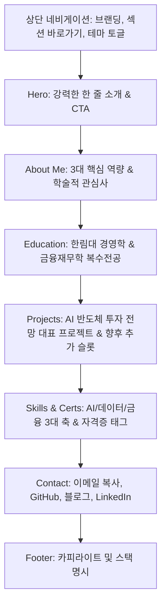
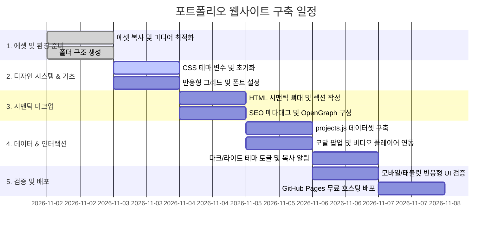

# 🚀 박준홍 포트폴리오 웹사이트 구축 계획서 (Portfolio Website Blueprint)

> **문서 버전:** v1.0  
> **작성일:** 2026년 11월 2일  
> **대상자:** 박준홍 (한림대학교 경영학과 / 금융재무학과 복수전공, 학번 20212954)  
> **목적:** 취업(인턴/신입) 및 대외활동·공모전 지원을 위한 개인 브랜딩 포트폴리오 웹사이트 구축

---

## 1. 사이트 목적 및 타깃 분석

### 1.1 사이트 구축 목적
- **개인 브랜딩 및 역량 증명:** 금융·경영 도메인에 대한 깊이 있는 통찰과 첨단 생성형 AI 및 데이터 분석 역량을 융합한 전문 역량을 직관적으로 전달
- **프로젝트 실적 아카이빙:** AI스마트워크 과제(반도체 슈퍼사이클 투자 리포트 및 자동화 덱)를 비롯한 주요 성과물을 고화질 멀티미디어(영상, 이미지, 보고서 구조)로 입체적 전시
- **지속 가능한 확장성:** 향후 진행될 데이터 분석 공모전, 금융 캡스톤, 대외활동 프로젝트를 코드 수정 없이 손쉽게 추가할 수 있는 구조 확보
- **온라인 접근성 극대화:** GitHub Pages 기반의 정적 웹 호스팅을 통해 무비용·고속 로딩 사이트 운영

### 1.2 핵심 타깃 독자 (Target Audience)
1. **핀테크 / 금융사 / IT 테크 기업 채용 담당자 및 실무 리서처**
   - 확인 포인트: 단순 코딩 수준을 넘어, 금융 산업 지식과 생성형 AI 툴을 실무 생산성에 어떻게 접목할 수 있는가?
2. **대외활동 / 데이터 분석 공모전 / 산학협력 프로젝트 심사위원**
   - 확인 포인트: 기획력, 문제 정의 능력, 데이터 검증(Fact-checking) 태도, 결과물 전달력(프레젠테이션)
3. **교수진 및 연구/프로젝트 동료**
   - 확인 포인트: 학업 성취도, 다학제 융합 역량(경영+금융+AI), 협업을 위한 커뮤니케이션 가능 여부

### 1.3 핵심 차별화 전략 (USP: Unique Selling Proposition)
- **"Finance Domain + Multi-Agent AI Engineering"**
  - 단순 프롬프트 입력자가 아닌, **작성 에이전트와 독립 검토(QA) 에이전트를 설계**하여 리포트의 신뢰도를 높인 AI 워크플로우 설계자
  - 슬라이드 제작 자동화를 위한 **커스텀 에이전트 스킬(`hallym-investment-deck`) 및 Node.js/Python 스크립트 자체 개발 역량**
  - 텍스트 분석에 머무르지 않고 Gemini(3D 표지 이미지), Veo(8초 시네마틱 영상)를 유기적으로 결합한 **멀티모달 AI 활용 능력**

---

## 2. 전체 섹션 구성 및 상세 콘텐츠

웹사이트는 단일 페이지 애플리케이션(SPA) 스타일의 부드러운 스크롤 인터랙션과 상세 보기 모달(Modal) 팝업 구조로 설계됩니다.



### 2.1 Header / Navigation Bar
- **위치:** 화면 상단 고정 (Sticky Glassmorphic Header)
- **구성:**
  - 좌측: 로고 텍스트 `Junhong Park` (부제: `Fintech & AI Analyst`)
  - 우측: 네비게이션 메뉴 (`About`, `Education`, `Projects`, `Skills`, `Contact`)
  - 기능 버튼: **라이트/다크 모드 전환 토글 스위치** (아이콘: ☀️ / 🌙)
  - 모바일 반응형: 화면 크기 768px 이하 시 햄버거 메뉴(드롭다운 오버레이) 제공

---

### 2.2 Hero (메인 인트로덕션)
- **카피라이트 안:**
  - **메인 타이틀:** "금융 데이터의 통찰과 AI 스마트워크를 잇는 분석가, 박준홍입니다."
  - **서브 타이틀:** "경영·재무 도메인 지식을 바탕으로 생성형 AI 다중 에이전트와 데이터 자동화 솔루션을 구축하여 실질적인 비즈니스 가치를 창출합니다."
- **배지(Badge):** `한림대학교 경영학과 & 금융재무학과` · `AI / Data Analytics`
- **행동 유도 버튼 (CTA):**
  - `[대표 프로젝트 탐색하기 ↓]` : 클릭 시 Projects 섹션으로 부드러운 스크롤
  - `[이력서 / 연락처 확인]` : 클릭 시 Contact 섹션으로 이동
- **비주얼 배경 효과:** 은은한 네이비-시안 그라데이션 글로우(Glow) 및 현대적인 테크 그리드 패턴

---

### 2.3 About (자기소개 및 핵심 역량)
박준홍 님의 3가지 차별화된 정체성을 3열 그리드 카드로 시각화합니다.

| 카드 번호 | 핵심 역량 키워드 | 세부 설명 및 가치 제안 |
|---|---|---|
| **Card 1** | **금융 & 산업 리서치 (Financial Valuation)** | 재무제표 심층 분석, 경기순환 산업 사이클 예측, 시나리오별 목표주가 및 확률가중 밸류에이션 모델링 |
| **Card 2** | **생성형 AI & 멀티에이전트 QA** | 프롬프트 엔지니어링, 작성 에이전트와 독립 검토(QA) 에이전트를 결합한 팩트체크 시스템 구축 |
| **Card 3** | **자동화 스킬 & 멀티모달 제작** | Antigravity 커스텀 스킬 개발, PPT 자동 생성 스크립트 제작, Gemini/Veo 기반 시네마틱 미디어 창작 |

- **가치관 요약 박스:**  
  *"기술은 분석의 속도를 높이고, 도메인 지식은 분석의 깊이를 결정합니다. 두 영역의 시너지를 통해 신뢰할 수 있는 데이터 결론을 도출합니다."*

---

### 2.4 Education (학력 및 전공)
타임라인 또는 구조화된 정보 카드로 전공 배경을 신뢰감 있게 전달합니다.

- **학교명:** 한림대학교 (Hallym University)
- **학위 과정:** 경영대학 학사 재학 (2021년 입학, 20212954)
- **전공 구성:**
  - **제1전공:** **경영학과 (Business Administration)**
    - 비즈니스 모델 분석, 경영전략, 관리회계, 마케팅 전략 기초
  - **복수전공:** **금융재무학과 (Finance)**
    - 재무관리, 기업재무론, 증권투자론, 금융시장과 데이터
- **주요 교과목 이수 및 학술 성과:**
  - `AI스마트워크`: 생성형 AI를 활용한 비즈니스 리서치, 다중 에이전트 품질 검증, 멀티모달 콘텐츠 파이프라인 우수 프로젝트 수행
  - `경영통계 및 재무분석`: 정량적 데이터 기반 의사결정 및 가치평가 모델 학습

---

### 2.5 Projects (프로젝트 쇼케이스 - 핵심 섹션)

#### [대표 프로젝트 1] AI스마트워크 중간과제
- **프로젝트명:** 「이번엔 다를까? — 2018년 슈퍼사이클과 비교한 메모리 반도체 투자 전망」
- **부제:** 사상 최대 이익, PER 4배의 역설을 분석한 다중 에이전트 기반 금융 리서치 & 자동화
- **진행 기간:** 2026.10 (AI스마트워크 중간고사 프로젝트)
- **역할:** 리서치 기획, 프롬프트 엔지니어링, 슬라이드 스킬 개발, 멀티모달 미디어 제작 (기여도 100%)
- **사용 기술 및 도구 태그:**
  `Claude Opus 5.5` `Google Gemini` `Google Veo` `Antigravity Custom Skill` `Node.js` `Python` `Financial Modeling`

##### 4단계 엔드투엔드 워크플로우 구성
1. **Step 1: 심층 산업 분석 & 밸류에이션 보고서 작성 (`.docx`)**
   - Hallym Investment 리서치센터 수석 애널리스트 관점에서 삼성전자·SK하이닉스 비교 분석
   - 2018년 vs 2026년 반도체 구조 비교(8대 항목), HBM 웨이퍼 잠식 효과 및 장기계약 구조 규명
   - 낙관/기본/비관 시나리오별 목표주가 및 확률가중 밸류에이션 모델 수립
2. **Step 2: 독립 검토 에이전트 기반 Multi-Agent QA 파이프라인**
   - 작성 에이전트와 분리된 별도 QA 책임자 에이전트 구동
   - 26건의 지적 사항(치명 3건, 중요 12건, 사소 11건) 도출 및 팩트체크
   - 2019년 재현 스트레스 테스트(-78%, -53%) 추가 및 PER 산출 근거 보강
3. **Step 3: 슬라이드 자동 생성 커스텀 에이전트 스킬 (`hallym-investment-deck`) 개발**
   - Antigravity Custom Skill 개발: 브랜드 아이덴티티(`brand.md`), 스토리라인 구조(`storyline.md`), 슬라이드 템플릿(`slide_types.md`) 체계화
   - `hallym_deck.js` (Node.js PPT 생성 엔진) 및 `qa_check.py` (슬라이드 검증 스크립트) 자체 개발
4. **Step 4: 멀티모달 비주얼 & 시네마틱 영상 제작**
   - Gemini 기반 16:9 비율의 고급 금융 리서치 3D 렌더링 표지 이미지 생성
   - Google Veo (Flow) 모델을 활용하여 표지 이미지를 첫 프레임으로 삼은 8초 시네마틱 홍보 티저 영상(MP4) 완성

##### 인터랙티브 쇼케이스 UI 기능
- **표지 이미지 뷰어:** 고화질 3D 표지 이미지(`20212954_중간고사_이미지.png`) 갤러리 카드
- **8초 비디오 플레이어:** 웹 브라우저 내에서 직접 재생/일시정지 가능한 HTML5 비디오 플레이어 내장 (`Memory_chip_glowing_data_stream_6e037af5.mp4`)
- **[자세히 보기] 인터랙티브 모달 팝업:**
  - 프로젝트 개요, 배경 문제 정의, 프롬프트 구조(`<role>`, `<context>`, `<quality_check>`)
  - QA 전후 비교 테이블(Fact Check 내역)
  - 핵심 결론 및 인사이트 (Hallym's View)

#### [신규 프로젝트 확장 영역 (Scalability)]
- `projects.js` 데이터 파일에 객체만 추가하면 웹사이트에 자동으로 신규 카드가 렌더링되는 구조
- 준비 중인 프로젝트 플레이스홀더 카드 2건 마련 (예: "금융 시계열 데이터 머신러닝 예측 모델", "기업 공시 데이터 기반 이상거래 탐지")

---

### 2.6 Skills & Certificates (보유 역량 & 자격증)

#### (1) 기술 및 역량 (3개 영역별 분할 카드)
```
[ 1. AI & Smart Work ]
• Multi-Agent QA Systems (독립 검토 파이프라인 설계)
• Advanced Prompt Engineering (Role/Context/Constraint 기법)
• Antigravity Custom Skills & Automation Scripting (JS/Python)
• Multimodal AI Production (Claude, Gemini, Google Veo)

[ 2. Data & Analytics ]
• Python (Pandas, NumPy, Matplotlib, Seaborn)
• SQL (데이터 추출, 집계, 서브쿼리, 윈도우 함수)
• 데이터 전처리, 결측치 정제 및 탐색적 데이터 분석 (EDA)
• 통계적 가설 검정 및 시계열 데이터 기초 분석

[ 3. Finance & Business ]
• 기업가치평가 (Relative Valuation PER/PBR, 시나리오 분석)
• 재무제표(BS/IS/CF) 분석 및 핵심 재무비율 도출
• 산업 사이클 및 거시경제 리서치
• 비즈니스 문서(IR 덱, 투자분석 보고서) 작성
```

#### (2) 자격증 및 어학 현황 (Status Badge 표시)
- **데이터 분석 분야:**
  - `SQLD (SQL 개발자)` : 준비 중 / 응시 예정 (Badge: `In Progress`)
  - `ADsP (데이터분석 준전문가)` : 준비 중 / 응시 예정 (Badge: `In Progress`)
  - `빅데이터분석기사` : 학습 중 (Badge: `Planned`)
- **금융 및 비즈니스 분야:**
  - `투자자산운용사` : 학습 중 (Badge: `Planned`)
  - `컴퓨터활용능력 1급` : 취득 완료 또는 준비 중 (Badge: `Active / In Progress`)
- **어학 및 글로벌:**
  - `TOEIC / OPIc` : 공인 어학 성적 관리 (Badge: `Verified`)

---

### 2.7 Contact & Links (연락처 및 대외 채널)
- **이메일 카드:**  
  - 박준홍 님의 대표 이메일 표기
  - **[원클릭 이메일 복사]** 버튼 (클릭 시 "이메일 주소가 복사되었습니다" 토스트 알림)
- **외부 소셜/포트폴리오 링크 (아이콘 그리드):**
  - **GitHub:** `github.com/사용자아이디` (코드 저장소 링크)
  - **Tech Blog:** Velog 또는 Tistory 링크 (학습 기록 및 기술 아티클 링크)
  - **LinkedIn:** 링크드인 프로필 연동 (비즈니스 네트워킹)
- **협업 제안 안내:**  
  *"데이터 분석, 금융 리서치, AI 스마트워크 프로젝트 협업 및 인턴십 관련 문의는 언제든 편하게 연락 부탁드립니다."*

---

### 2.8 Footer
- `© 2026 Junhong Park. All Rights Reserved.`
- `Built with Semantic HTML5, Modern CSS, and Vanilla JavaScript. Hosted on GitHub Pages.`

---

## 3. 디자인 가이드 (Design System)

### 3.1 디자인 컨셉: Modern Tech-Finance
- **키워드:** 신뢰감(Trust), 지적임(Intelligence), 첨단 테크(High-Tech), 미니멀리즘(Minimalism)
- **시각적 은유:** 금융 리서치의 깊이 있는 네이비 톤과 HBM 반도체 데이터 스트림의 청록·골드 빛을 절묘하게 융합

### 3.2 컬러 시스템 (Color Palette)

| 구분 | 토큰명 | 라이트 모드 (기본) | 다크 모드 | 용도 및 의미 |
|---|---|---|---|---|
| **Primary Base** | `--bg-main` | `#F8FAFC` (Slate 50) | `#0B0F17` (Deep Dark) | 전체 웹페이지 배경 |
| **Card / Surface** | `--bg-card` | `#FFFFFF` (Pure White) | `#151D2A` (Navy Slate) | 섹션 카드, 모달 팝업 배경 |
| **Border / Line** | `--border-color` | `#E2E8F0` (Slate 200) | `#26354A` (Subtle Navy) | 카드 테두리, 구분선 |
| **Brand Primary** | `--primary` | `#0A2540` (Navy Corporate) | `#38BDF8` (Bright Sky) | 헤드라인, 핵심 브랜드 포인트 |
| **Accent 1 (AI/Tech)** | `--accent-cyan` | `#0284C7` (Vibrant Cyan) | `#00F2FE` (Neon Cyan) | HBM 칩, 테크 태그, 비디오 하이라이트 |
| **Accent 2 (Finance)** | `--accent-gold` | `#D97706` (Rich Amber) | `#FBBF24` (Gold Light) | 데이터 스트림, 주요 성과 배지 |
| **Text Primary** | `--text-primary` | `#0F172A` (Slate 900) | `#F8FAFC` (Slate 50) | 본문 주요 제목, 가독성 텍스트 |
| **Text Secondary** | `--text-muted` | `#64748B` (Slate 500) | `#94A3B8` (Slate 400) | 설명 문구, 메타 정보, 캡션 |

### 3.3 타이포그래피 (Typography)
- **국문 서체:** `Pretendard`, `-apple-system`, `sans-serif` (현대적이고 가장 가독성이 높은 폰트)
- **영문/숫자 서체:** `Inter`, `Outfit` (금융 지표, 기술 태그, 영어 타이틀의 세련미 강화)
- **코드/데이터 서체:** `JetBrains Mono`, `monospace` (프롬프트 코드 블록 및 수치 데이터 표시)
- **계층 구조:**
  - `Hero Heading (h1)`: 40px ~ 48px, Bold (700)
  - `Section Heading (h2)`: 28px ~ 32px, Semi-Bold (600)
  - `Card Title (h3)`: 20px ~ 22px, Medium (500)
  - `Body Text (p)`: 15px ~ 16px, Regular (400), 행간(line-height) 1.65

### 3.4 UI 요소 및 마이크로 인터랙션
- **Glassmorphism:** 헤더 및 카드에 은은한 블러 필터 적용 (`backdrop-filter: blur(12px)`)
- **Hover Micro-Animations:** 카드 마우스 오버 시 Y축 살짝 상승(`translateY(-4px)`) 및 경계선에 시안빛 글로우 효과 부여
- **모달 애니메이션:** 모달 오픈 시 부드러운 페이드인과 스케일업 효과
- **다크/라이트 테마 전환:** CSS 변수 트랜지션(`transition: background-color 0.3s, color 0.3s`)을 적용해 눈부심 없는 부드러운 전환

---

## 4. 기술 스택 및 프로젝트 폴더 구조

### 4.1 기술 스택
- **Markup:** Semantic HTML5 (W3C 표준 준수, 접근성 ARIA 라벨, OpenGraph SEO 태그 포함)
- **Styling:** Vanilla CSS3 (CSS Variables, Flexbox, CSS Grid, Media Query)
  - 외부 프레임워크(Tailwind/Bootstrap) 의존성 없는 가볍고 깨끗한 코드
- **Logic:** Vanilla JavaScript (ES6+)
  - `projects.js` 데이터 분리 모델을 활용한 자동 렌더링
  - DOM 조작, 로컬 스토리지 기반 테마 기억(Theme Persistence), 모달 제어
- **호스팅/배포:** GitHub Pages (무료 SSL HTTPS 인증서 자동 제공)

### 4.2 프로젝트 디렉토리 구조
```
wnsghd0711!/
├── index.html                      # 메인 페이지 (시맨틱 구조 & 반응형 레이아웃)
├── css/
│   ├── reset.css                   # 브라우저 기본 스타일 초기화
│   ├── variables.css               # 테마 변수 (다크/라이트 모드 색상, 폰트, 간격)
│   └── style.css                   # 전체 레이아웃, 컴포넌트, 모달, 애니메이션
├── js/
│   ├── data/
│   │   └── projects.js             # ★ 프로젝트 데이터셋 (신규 추가가 매우 쉬운 구조)
│   ├── main.js                     # 테마 토글, 스크롤 애니메이션, 복사 버튼
│   └── modal.js                    # 프로젝트 상세 팝업 및 비디오 재생 제어
├── assets/
│   ├── images/
│   │   ├── profile.png             # 프로필 이미지 (또는 아이콘)
│   │   ├── semiconductor-cover.png # 중간과제 3D 표지 이미지 (Gemini 산출물)
│   │   └── icons/                  # GitHub, 블로그, 이메일, 기술 스택 SVG 아이콘
│   ├── videos/
│   │   └── semiconductor-teaser.mp4# 8초 시네마틱 홍보 티저 영상 (Veo 산출물)
│   └── docs/
│       ├── report-summary.pdf      # (선택) 리포트 요약본 다운로드 파일
│       └── presentation-deck.pdf   # (선택) 슬라이드 요약본 다운로드 파일
├── PORTFOLIO_PLAN.md               # 구축 계획서 (본 파일)
└── README.md                       # GitHub 레포지토리 소개 및 배포 설명서
```

### 4.3 손쉬운 프로젝트 추가 메커니즘 (`projects.js`)
HTML을 직접 수정하지 않고, 아래와 같이 `js/data/projects.js`에 데이터 객체를 추가하기만 하면 웹사이트에 자동으로 새 프로젝트 카드가 생성됩니다.

```javascript
// js/data/projects.js 예시 구조
const projectsData = [
  {
    id: "semiconductor-supercycle",
    title: "이번엔 다를까? — 메모리 반도체 투자 전망",
    subtitle: "사상 최대 이익, PER 4배의 역설을 분석한 AI 멀티에이전트 금융 리서치",
    period: "2026.10",
    featured: true,
    category: "AI Smart Work & Finance",
    tags: ["Claude Opus", "Gemini", "Google Veo", "Antigravity Skill", "Valuation"],
    thumbnail: "assets/images/semiconductor-cover.png",
    video: "assets/videos/semiconductor-teaser.mp4",
    summary: "삼성전자와 SK하이닉스의 2018년 vs 2026년 구조를 비교하고, 독립 QA 에이전트로 팩트체크를 거친 10쪽 심층 리포트 및 자동화 덱 생성 프로젝트",
    details: {
      objective: "핵심 질문 '이번 슈퍼사이클은 2018년처럼 끝날 것인가?'에 대한 데이터 기반 해답 제시",
      tools: [
        { name: "Claude Opus 5.5", role: "자료 리서치, 보고서 작성, 시나리오 밸류에이션, 독립 QA 에이전트" },
        { name: "Antigravity Skill", role: "hallym-investment-deck 슬라이드 생성 및 파이썬 QA 스크립트" },
        { name: "Google Gemini", role: "3D 렌더링 스타일 금융 리포트 표지 이미지 생성" },
        { name: "Google Veo", role: "표지 이미지 기반 8초 시네마틱 홍보 영상 제작" }
      ],
      process: [
        "사전 기획: 2018년 슈퍼사이클과의 구조적 차별화 관점 도출",
        "초안 리포트 작성: 시나리오별 목표주가 및 확률가중 밸류에이션 산출",
        "독립 검토 QA: 26건의 피드백 반영 및 2019년 스트레스 테스트 추가",
        "자동화 및 멀티모달: Antigravity 커스텀 스킬로 슬라이드 덱 자동 생성 및 시네마틱 영상 제작"
      ],
      insights: "생성형 AI를 단순한 텍스트 생성기가 아닌, '작성 에이전트 + 검증 에이전트'의 상호 검증 파이프라인으로 구성할 때 비로소 금융 실무 수준의 신뢰성을 확보할 수 있음을 입증."
    }
  }
  // 향후 신규 프로젝트는 여기에 객체 복사로 즉시 추가 가능!
];
```

---

## 5. 단계별 구현 순서 (Implementation Roadmap)



### 상세 실행 단계
1. **[Step 1] 미디어 에셋 마이그레이션:**
   - `20212954_박준홍_ai스마트워크 중간과제물/` 폴더 내의 표지 이미지(`20212954_중간고사_이미지.png`)와 8초 영상(`Memory_chip_glowing_data_stream_6e037af5.mp4`)을 `assets/` 하위 디렉토리로 이동 및 최적화
2. **[Step 2] CSS 디자인 시스템 구축:**
   - `variables.css`에 다크/라이트 테마 변수 구축 및 Pretendard / Inter 폰트 CDN 연결
   - `reset.css` 및 `style.css` 작성
3. **[Step 3] HTML5 구조 및 섹션 마크업:**
   - Nav, Hero, About, Education, Projects Container, Skills, Contact, Footer 구현
   - 검색엔진 최적화(SEO) 및 카카오톡/링크드인 공유 시 썸네일이 뜨는 OpenGraph 태그 적용
4. **[Step 4] 프로젝트 동적 렌더링 & 모달 스크립트 작성:**
   - `projects.js`에 AI스마트워크 과제 정보 구조화
   - 카드 클릭 시 세부 탭(개요, 도구, 파이프라인, 인사이트, 미디어)이 열리는 모달 창 구현
5. **[Step 5] 인터랙션 & 반응형 최적화:**
   - 이메일 복사 시 토스트 메시지 출력
   - 미디어 쿼리(Breakpoints: 480px, 768px, 1024px, 1280px)를 통한 모바일/태블릿/데스크톱 완벽 지원
6. **[Step 6] 크로스 브라우징 및 성능 테스트:**
   - Chrome, Safari, Firefox 및 모바일 브라우저 렌더링 확인
7. **[Step 7] GitHub Pages 배포:**
   - 저장소 생성 후 Push 및 배포 완료

---

## 6. GitHub Pages 무료 배포 가이드

누구나 무료로 5분 만에 평생 무료 호스팅(HTTPS 보안 연결 포함)을 적용할 수 있는 단계별 매뉴얼입니다.

### Step 1: GitHub 저장소(Repository) 생성
1. [GitHub](https://github.com)에 로그인 후 우측 상단의 **[+] → [New repository]** 클릭
2. 저장소 이름 설정:
   - 개인 메인 주소로 쓸 경우: `<깃허브아이디>.github.io` (예: `junhong-park.github.io`)
   - 서브 프로젝트로 쓸 경우: `portfolio` 또는 `my-site`
3. 공개 범위: **Public** 선택 (GitHub Pages 무료 배포는 Public 저장소에서 지원)
4. **[Create repository]** 버튼 클릭

### Step 2: 로컬 코드를 GitHub 저장소에 Push
터미널을 열고 프로젝트 루트 폴더에서 다음 명령어를 순서대로 실행합니다:

```bash
# 1. git 초기화
git init

# 2. 모든 파일 추가
git add .

# 3. 첫 번째 커밋 생성
git commit -m "feat: 대학생 포트폴리오 웹사이트 초기 구축 완료"

# 4. 기본 브랜치를 main으로 설정
git branch -M main

# 5. 원격 저장소 연결 (본인의 GitHub 저장소 URL 입력)
git remote add origin https://github.com/<깃허브아이디>/<저장소이름>.git

# 6. 원격 저장소에 코드 업로드
git push -u origin main
```

### Step 3: GitHub Pages 활성화
1. GitHub 저장소 페이지의 상단 메뉴에서 **[Settings]** 탭 클릭
2. 좌측 사이드바에서 **[Pages]** 메뉴 클릭
3. **Build and deployment** 섹션의 **Source** 설정을 `Deploy from a branch`로 선택
4. **Branch** 항목에서:
   - 브랜치: `main` 선택
   - 폴더: `/ (root)` 선택
5. **[Save]** 버튼 클릭

### Step 4: 배포 확인 및 접속
1. 약 1~2분 후 상단에 **"Your site is live at https://<깃허브아이디>.github.io/"** 알림 배너가 표시됩니다.
2. 해당 URL을 클릭하면 전 세계 어디서나 접속 가능한 본인의 포트폴리오 사이트가 열립니다.
3. 이력서, 자기소개서, 대외활동 지원서, 링크드인 프로필에 해당 주소를 기재하여 활용합니다.

---

## 7. 향후 유지관리 및 확장 팁 (Maintenance Tips)
1. **신규 프로젝트 추가 시:**
   - `assets/images/`에 썸네일 이미지를 넣고, `js/data/projects.js` 배열 끝에 새 프로젝트 객체를 추가한 뒤 `git commit` & `push`만 하면 웹사이트에 즉시 반영됩니다.
2. **자격증 취득 시:**
   - `index.html`의 Skills & Certificates 섹션에서 배지 클래스를 `status-progress`에서 `status-active`로 변경하고 텍스트를 `취득 완료`로 갱신합니다.
3. **이력서 PDF 연동:**
   - 최신 국문/영문 이력서를 `assets/docs/resume.pdf`로 저장해 두면 방문자가 버튼 클릭 한 번으로 다운로드할 수 있습니다.
